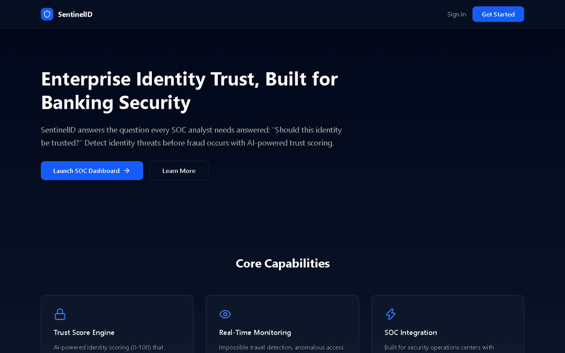
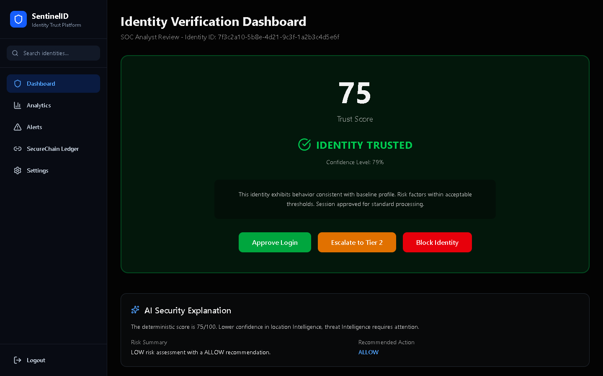
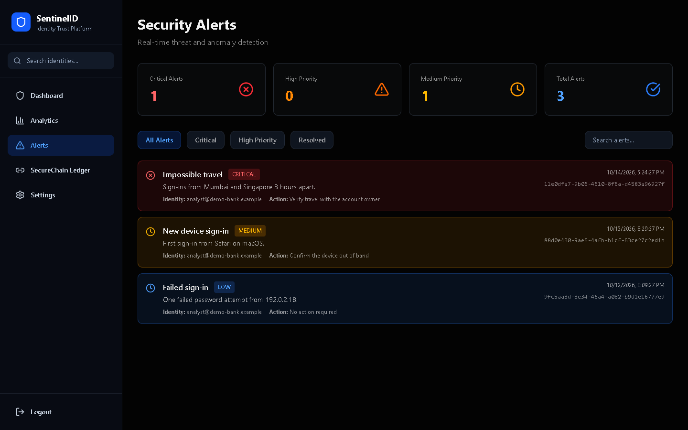
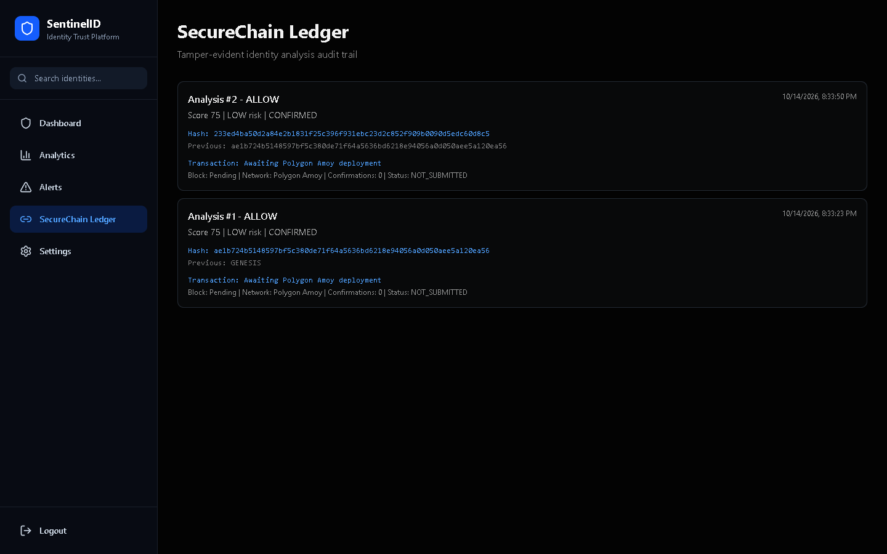
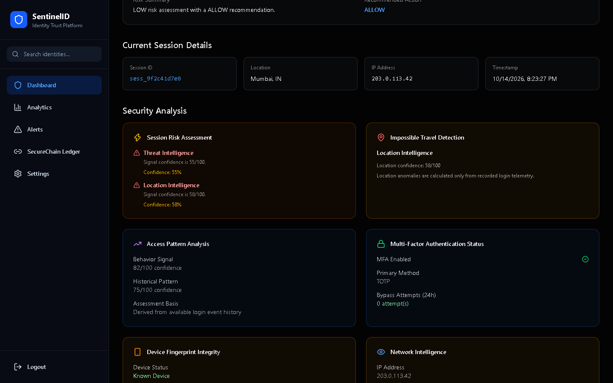
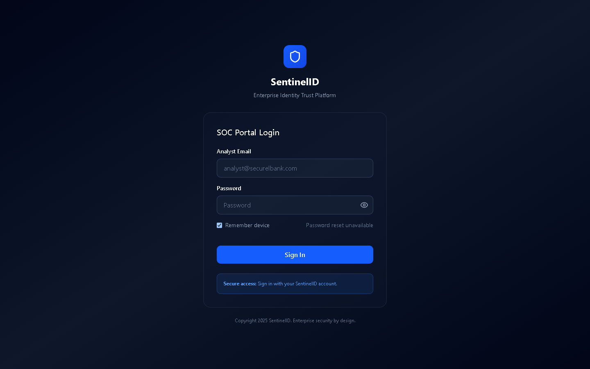
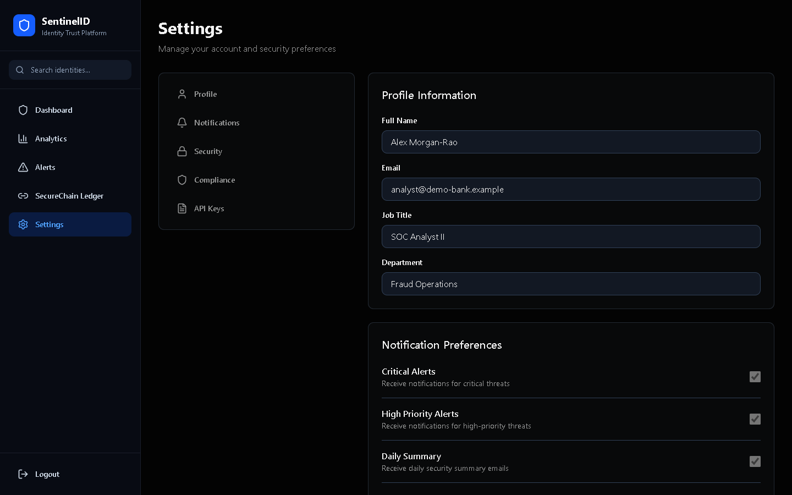
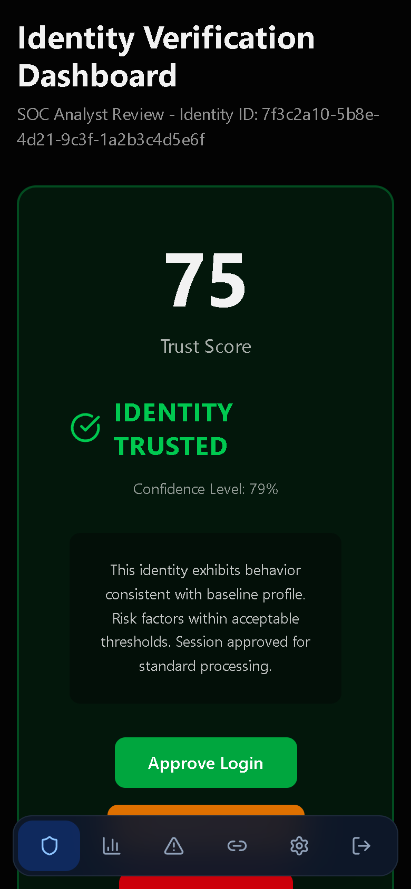
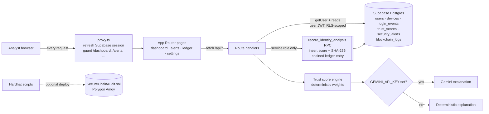

<p align="center"></p>

<p align="center">
  
  
  
  
  
  
</p>

<p align="center">
  
</p>

## What it is

**SentinelID** is a dashboard for security-operations (SOC) analysts. It answers one question: *should this identity be trusted?*

For the signed-in identity, the app reads the device, sign-in and alert history from Supabase and combines five weighted signals into a deterministic **0–100 trust score**. The score comes with a risk level and an **ALLOW / VERIFY / BLOCK** recommendation. It explains the result in plain language, using Gemini when a key is set and a deterministic summary otherwise. Every analysis is stored in **SecureChain**, a per-user SHA-256 hash chain, so that any edit or deletion of an earlier analysis breaks the chain.

<p align="center"></p>

## Features

| | Feature | Details |
| --- | --- | --- |
| 🛡️ | **Trust score engine** | `lib/trustScore/engine.ts` weights device trust (0.30), behaviour (0.25), location (0.20), threat intelligence (0.15) and sign-in history (0.10) into a score, a risk level, a decision, a confidence value and risk factors. |
| 🤖 | **AI explanation** | `services/geminiService.ts` asks Gemini to *explain* the score in plain language, never to change it. Without a key, it falls back to a deterministic explanation. |
| 🔗 | **SecureChain ledger** | Each analysis is written by a database function that chains its SHA-256 hash to the previous entry (`GENESIS` for the first). You can browse the chain at `/ledger`. |
| 🚨 | **Security alerts** | `/alerts` lists the user's alerts with severity counts, filters (all, critical, high, resolved) and search. |
| 📊 | **Analyst dashboard** | `/dashboard` shows the trust score and verdict, the AI explanation, the current session, MFA and device status, threat matches and recent activity. It runs an analysis automatically on the first visit. |
| 👤 | **Profile settings** | `/settings` lets the analyst edit their name, job title and department, validated server-side with Zod. |
| 🔐 | **Auth & data isolation** | Supabase Auth handles sign-in. `proxy.ts` refreshes the session and protects the app routes. Row-level security scopes every table to its owner, and only the server (service role) can record analyses. |
| ⛓️ | **Polygon Amoy contract** | `contracts/SecureChainAudit.sol` comes with Hardhat compile and deploy scripts. The app doesn't anchor to the chain yet (see *Future development*). |

## Screenshots

<sub>Captured from the current build, running against a local mock backend with **fictional demo data** (a demo analyst account and made-up IPs from documentation ranges).</sub>

| Dashboard | Security alerts |
| --- | --- |
|  |  |
| **SecureChain ledger** | **Session details & security analysis** |
|  |  |
| **Sign in** | **Settings** |
|  |  |

<details>
<summary>📱 Mobile and landing page</summary>

<p>
  
  &nbsp;
  
</p>
</details>

## Architecture



An identity analysis (`POST /api/identity-analysis`) runs in this order:

1. Verify the caller's session.
2. Read their devices, sign-ins and alerts (RLS-scoped).
3. Calculate the score.
4. Explain it.
5. Persist the score and its ledger entry through the service-role RPC.

## Quickstart

```bash
git clone https://github.com/ekupekuAI/Sentinel-ID.git
cd Sentinel-ID/sentinel-id
npm ci
cp .env.example .env.local      # fill in the values below
npm run dev                     # http://localhost:3000
```

1. **Database:** create a Supabase project and apply every SQL file in `sentinel-id/supabase/migrations/` in order. Use `supabase db push`, or paste them into the SQL editor.
2. **Users:** create analyst accounts in Supabase → Authentication → Users. The app has no public sign-up.
3. **Check:** run `npm run lint` and `npm run build`.

## Environment variables

| Variable | Required | Where to get it |
| --- | --- | --- |
| `NEXT_PUBLIC_SUPABASE_URL` | ✅ | Supabase → Project Settings → API → Project URL |
| `NEXT_PUBLIC_SUPABASE_PUBLISHABLE_KEY` | ✅ | Supabase → Project Settings → API → anon / publishable key |
| `SUPABASE_SERVICE_ROLE_KEY` | ✅ **server-only** | Supabase → Project Settings → API → service_role / secret key. Required to record analyses. Never expose it to the browser. |
| `GEMINI_API_KEY` | optional | [Google AI Studio](https://aistudio.google.com/app/apikey). Without it, explanations are deterministic. |
| `GEMINI_MODEL` | optional | Defaults to `gemini-2.0-flash` |
| `RPC_URL` | optional | Polygon Amoy RPC, e.g. from [Alchemy](https://dashboard.alchemy.com). Only needed for contract deployment. |
| `PRIVATE_KEY` | optional | A **throwaway test wallet** key, used only for `npm run contract:deploy:amoy` |
| `CONTRACT_ADDRESS` | optional | Printed by the deploy script |
| `POLYGON_AMOY_CHAIN_ID` | optional | Defaults to `80002` |

When a required key is missing, the app shows a clear message instead of crashing. The login page warns that Supabase isn't configured and disables sign-in, and analysis reports the missing `SUPABASE_SERVICE_ROLE_KEY`.

<details>
<summary>📁 Project structure</summary>

```text
sentinel-id/
├── app/
│   ├── page.tsx                  # landing page
│   ├── login/                    # Supabase email + password sign-in (honours ?next=)
│   ├── dashboard/                # trust score, AI explanation, session & security cards
│   ├── alerts/                   # alert list with filters and search
│   ├── ledger/                   # SecureChain hash-chained audit entries
│   ├── analytics/                # placeholder (not configured yet)
│   ├── settings/                 # profile form
│   └── api/                      # dashboard · identity-analysis · alerts · ledger · profile
├── components/                   # Sidebar + dashboard cards
├── lib/
│   ├── trustScore/engine.ts      # deterministic scoring
│   ├── supabase/                 # browser, server, proxy and service-role clients
│   ├── safeRedirect.ts           # same-origin ?next= validation
│   └── validation.ts             # Zod schemas
├── repositories/                 # Supabase queries
├── services/                     # analysis, Gemini, client API wrappers
├── supabase/migrations/          # schema, RLS, hash-chain functions, hardening
├── contracts/SecureChainAudit.sol
├── blockchain/                   # ethers helpers + deploy script (not wired into the app)
└── proxy.ts                      # session refresh + route protection
```
</details>

## What's new in this version

| Before | After |
| --- | --- |
| 🔓 Any signed-in user could call `record_identity_analysis` from the browser with the public key and record a **forged 100 / ALLOW** score and ledger entry. | 🔒 EXECUTE is revoked from `public`, `anon` and `authenticated`. Only the server, using the service role after verifying the session, can record analyses (migration `20261014000000_harden_analysis_writes.sql`). |
| 🔓 The profile UPDATE policy let users rewrite any column of their row, including `email`. | 🔒 A column-level grant limits edits to `full_name`, `job_title` and `department`. |
| Every dashboard load re-upserted the profile and **reset the name** you had edited in Settings. | The profile row is only back-filled when it's missing, never overwritten. |
| `?next=` was ignored after login, so you always landed on `/dashboard`. | You return to the page you requested. The value is validated as a same-origin path, so it can't be used as an open redirect. |
| The login page gave no hint when Supabase wasn't configured. | It shows a clear configuration message and disables sign-in. |
| A profile validation error returned a raw JSON dump of Zod issues. | The first readable message is returned. |
| Timestamps were formatted on the server, in the server's locale and time zone. | The API returns ISO strings, which the browser formats locally. |
| Settings → **Cancel** did nothing. | Cancel restores the last saved values. |
| The "Total Alerts (24h)" tile counted all alerts. | It's labelled "Total Alerts". |
| `package-lock.json` was out of sync, so `npm ci` failed. | The lockfile is in sync. |

## Future development

These parts of the UI exist but aren't implemented yet:

- **Analytics:** `/analytics` is a placeholder until analytics calculations are built.
- **Analyst decisions:** *Approve Login* and *Block Identity* show a notice, but no durable approval or block workflow exists yet. *Escalate to Tier 2* re-runs the analysis.
- **Telemetry ingestion:** nothing in the app writes devices, sign-in events or alerts yet. They must come from an external source or be seeded.
- **On-chain anchoring:** `blockchain/ledgerSyncService.ts` isn't called. Before you wire it up, change it to pass the contract's `lastAuditHash()` as the previous hash; the contract rejects anything else.
- **Account features:** public sign-up, password reset, MFA and API-key management, notifications and the sidebar identity search.
